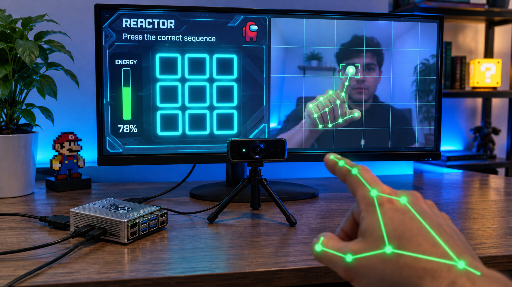
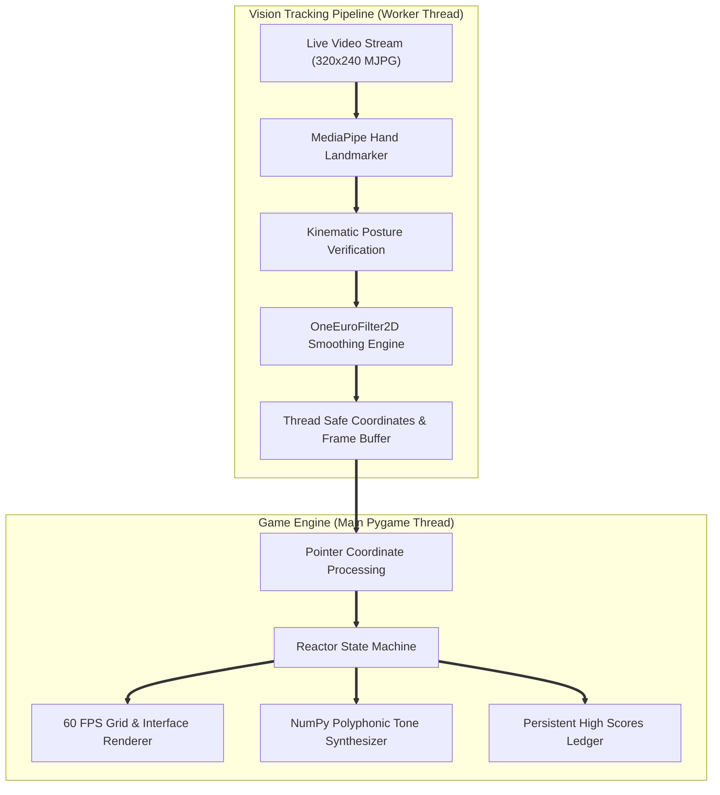

# MemorizeIt: Touchless Grid Memory Game for Raspberry Pi 4

<p align="center">
  
</p>

<p align="center">
  <b>An interactive touchless memory game powered by computer vision and artificial intelligence</b>
  <br>
  Built with Python, Pygame, OpenCV, and Google MediaPipe for the Raspberry Pi 4
</p>

## About The Project

MemorizeIt brings classic spatial pattern memory into the touchless realm. Instead of tapping physical buttons or touching a glass screen, you interact entirely through natural hand gestures in mid air.

The system tracks your index finger with high precision using neural networks, calculates hand kinematics, and projects an interactive 3x3 reactor grid alongside a real time camera feed. Designed specifically for the Raspberry Pi 4 single board computer, MemorizeIt delivers a smooth 60 frames per second experience through dedicated processing threads.

## System Architecture

The game divides workloads across two concurrent threads to guarantee fluid animations and low latency tracking without frame drops.



### Vision Tracking Pipeline

* **Neural Hand Tracking:** Google MediaPipe Hand Landmarker tracks 21 distinct joints in three dimensions, focusing exclusively on hand geometry and ignoring faces or complex backgrounds.
* **Kinematic Posture Verification:** To prevent accidental triggers, the vision engine requires your index finger to be extended while your other fingers curl naturally toward your palm.
* **Adaptive Jitter Elimination:** An adaptive OneEuroFilter2D filter eliminates small finger tremors during hover while maintaining immediate reaction to swift intentional movements.
* **Automatic Fallback Engine:** If the neural model file is absent, an OpenCV vision tracker takes over automatically using adaptive lighting equalization and skin tone segmentation.

### Game Engine and Audio

* **Decoupled Architecture:** The vision thread feeds coordinates to the main thread through thread safe variables, keeping the Pygame rendering loop at a solid 60 frames per second.
* **Procedural Sound Synthesis:** Dynamic tones from musical pitch C4 to D5 are generated in memory using pure NumPy wave synthesis, requiring no external sound clips.
* **Local Scoreboard:** Completed round scores persist automatically to a local highscores JSON file.

## Game Rules and How to Play

1. **Activation Dwell (5 Seconds):** At the standby screen, position your index finger within the central target circle shown in the camera feed. Hold it steady for 5 seconds as the countdown timer sounds.
2. **Memorize the Pattern:** The 3x3 grid lights up in an expanding sequence accompanied by distinct musical notes. Watch and listen closely.
3. **Reproduce the Sequence (2.0 Seconds Dwell):** Aim your finger at each target panel in sequence. Hovering continuously for 2.0 seconds charges the panel energy gauge and confirms your selection.
4. **Infinite Progression:** Every round you successfully clear adds one additional step to the pattern without limit.
5. **Game Over:** Choosing an incorrect panel triggers an alarm, flashes the board red, saves your score, and returns to standby mode.

## System Requirements

* **Computer:** Raspberry Pi 4 Model B (2 GB RAM or higher recommended) running Raspberry Pi OS 64 bit or Ubuntu Linux.
* **Camera:** Standard USB webcam supporting UVC or official Raspberry Pi Camera Module.
* **Monitor:** HDMI display running at 1280x720 resolution or higher.
* **Software:** Python version 3.10 or newer.

## Installation and Setup

1. Clone the repository to your local machine:
   ```bash
   git clone https://github.com/AndresM9802/MemorizeIt-Raspberry.git
   cd MemorizeIt-Raspberry
   ```

2. Install system libraries and set execution permissions:
   ```bash
   chmod +x scripts/install_dependencies.sh run.sh
   ./scripts/install_dependencies.sh
   ```

3. Create and activate a Python virtual environment:
   ```bash
   python3 -m venv --system-site-packages .venv
   source .venv/bin/activate
   pip install --upgrade pip
   pip install -r requirements.txt
   ```

4. Start the game:
   ```bash
   ./run.sh
   ```

   You can also specify a custom camera index directly:
   ```bash
   python3 main.py --cam 0
   ```

## Keyboard Controls

* **Space or Enter:** Instantly begin the game from standby or restart after a game over.
* **C:** Switch between connected camera inputs.
* **B:** Recalibrate tracking filters and reset coordinate offsets.
* **R:** Reset the board and return immediately to the standby screen.
* **Esc:** Exit the game cleanly.

## Documentation

For a detailed walkthrough on setting up your camera, perfecting your hand posture, and troubleshooting your environment, please read the complete [USAGE.md](file:///home/andres/Documents/OwnProjects/MemorizeIt-Raspberry/USAGE.md) guide.

## License

This project is licensed under the MIT License. See the [LICENSE](file:///home/andres/Documents/OwnProjects/MemorizeIt-Raspberry/LICENSE) file for full details.
