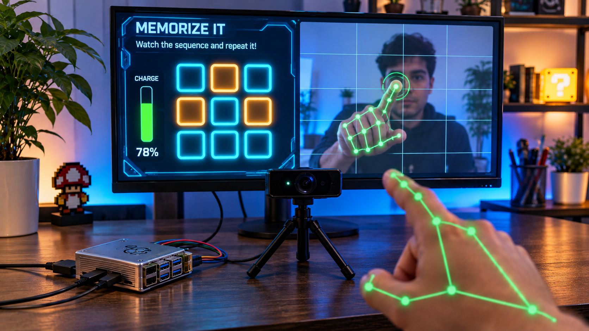

# MemorizeIt: Touchless Grid Memory Game for Raspberry Pi 4



MemorizeIt is a contactless 3x3 grid memory game developed in Python using Pygame, OpenCV, and Google MediaPipe. The system is designed for a Raspberry Pi 4 (Broadcom BCM2711, Quad-Core ARM Cortex-A72 @ 1.8 GHz) with a standard USB webcam or CSI camera module. Players interact completely touch-free using computer-vision-based finger tracking in mid-air.

---

## Architecture Overview

The system runs a thread-decoupled architecture designed to sustain a 60 FPS user interface while running real-time neural network inference:

1. **Vision Tracking Pipeline (Background Worker Thread):**
   * **Primary Engine (MediaPipe Hand Landmarker):** Uses the Tasks API (`models/hand_landmarker.task`) accelerated via CPU XNNPACK delegates. Captures and scales video frames to 320x240 for sub-15ms inference, tracking 21 3D hand joints while completely ignoring facial and background features.
   * **Kinematic Posture Verification:** Ensures deliberate input by calculating 3D Euclidean distances between joint landmarks. A touch point is only registered when the index finger (Landmark 8) is extended and adjacent fingers (middle, ring, pinky) remain curled toward the palm.
   * **Adaptive Low-Pass Filtering:** Employs a custom `OneEuroFilter2D` with velocity-dependent cutoff frequency and deadband thresholds, eliminating tracking jitter while preserving responsiveness.
   * **OpenCV CLAHE Fallback:** If MediaPipe or its model file is absent, the engine falls back to an OpenCV tracker using CLAHE lighting equalization, dual YCrCb/HSV skin thresholding, and morphological filtering.
   * **Zero-Copy Frame Transfer:** Decodes incoming frames with MJPG hardware acceleration (`CAP_PROP_BUFFERSIZE = 1`) and renders camera overlays off-thread into a Pygame surface buffer using `pygame.image.frombuffer()`.

2. **Game Engine and Audio Synthesis (Main Thread):**
   * **State Machine:** Manages transitions across standby, pattern demonstration, player interaction, round success, and game over states.
   * **Pure NumPy Audio Synthesizer:** Generates polyphonic sine and square wave tones in real time using dynamic audio channel matching (mono/stereo) without requiring external audio asset files.
   * **Persistent Scoreboard:** Records completed rounds to `highscores.json` and updates the on-screen leaderboard.

---

## Game Rules and Interaction

* **Start Dwell (5 Seconds):** From standby mode, hold your index finger within the central circle of the camera feed for 5 continuous seconds. A circular progress ring and countdown beeps will confirm initiation.
* **Pattern Playback:** The board displays a randomized sequence across the 9 panels, accompanied by corresponding audio frequencies (C4 to D5).
* **Panel Dwell (2.0 Seconds):** Aim your index finger at the target panel for 2.0 continuous seconds to charge the energy bar and submit your choice. A 0.20-second loss-of-tracking tolerance prevents accidental input breaks.
* **Infinite Progression:** Clearing a sequence increments the round counter and appends another panel to the pattern.
* **Sequence Mismatch (Game Over):** Selecting an incorrect panel triggers an error alarm, flashes the grid red, saves the final completed score to `highscores.json`, and returns to standby.

---

## Hardware and System Requirements

* **Single-Board Computer:** Raspberry Pi 4B (2 GB RAM or higher recommended) running Raspberry Pi OS (64-bit) or Ubuntu.
* **Camera:** Any standard USB UVC webcam (e.g., 720p/1080p @ 30 FPS) or Raspberry Pi Camera Module.
* **Display:** HDMI monitor with a minimum resolution of 1280x720.
* **Dependencies:** Python 3.10+, OpenCV (`opencv-python`), Pygame (`pygame` or `pygame-ce`), NumPy, and MediaPipe.

---

## Installation and Execution

1. **Clone the repository:**
   ```bash
   git clone https://github.com/AndresM9802/MemorizeIt-Raspberry.git
   cd MemorizeIt-Raspberry
   ```

2. **Install system packages:**
   ```bash
   chmod +x scripts/install_dependencies.sh run.sh
   ./scripts/install_dependencies.sh
   ```

3. **Set up the virtual environment:**
   ```bash
   python3 -m venv .venv
   source .venv/bin/activate
   pip install --upgrade pip
   pip install -r requirements.txt
   ```

4. **Launch the game:**
   ```bash
   ./run.sh
   ```

   Or run directly with specific camera selection:
   ```bash
   python3 main.py --cam 0
   ```

---

## Runtime Keyboard Controls

* **Space / Enter:** Instant game start or manual restart from standby / game over.
* **C:** Cycle through available connected camera devices.
* **B:** Recalibrate tracking filters and reset smoothing coordinates.
* **R:** Force reset to initial standby state.
* **Esc:** Exit application cleanly.
